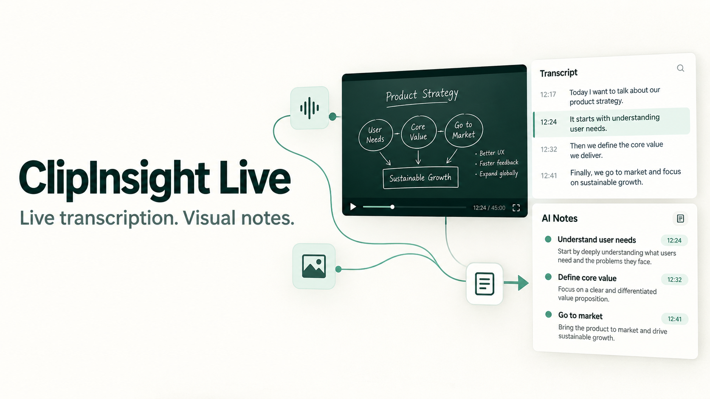
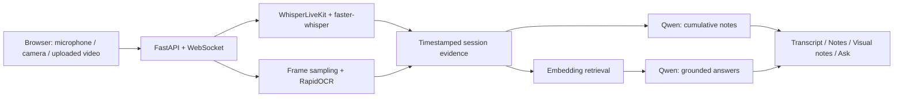

# ClipInsight Live

**Live transcription and AI notes from speech, slides, and whiteboards.**



ClipInsight Live is a local web application that combines streaming speech recognition with screen-text OCR. It turns lectures and presentations into English summaries, highlights, and searchable evidence, while keeping the original transcript in its spoken language.

The cover above is an illustrative product concept, rather than a screenshot of a recorded session.

## Features

- **Live recording:** microphone input, optional camera preview, partial and confirmed transcripts.
- **Video uploads:** MP4, MOV, WebM, MKV, and M4V; up to 512 MB and 60 minutes.
- **Visual notes:** extract text from selected video frames or camera snapshots, with timestamps and thumbnails.
- **Cumulative notes:** English summaries and highlights update during a session and after it ends.
- **Evidence-based questions:** retrieve relevant speech and OCR text and show timestamped sources.
- **Export:** Markdown notes and JSON session data.

## Architecture



The browser UI uses plain HTML, CSS, and JavaScript. The backend runs on the same computer, or on a Windows GPU machine reached through a private SSH tunnel. No frontend build step is required.

## Quick start

Use Python 3.12 and a running local Ollama installation. Install Python dependencies in a virtual environment:

```sh
python3.12 -m venv .venv
source .venv/bin/activate
python -m pip install -r requirements.txt
ollama pull qwen3:1.7b
ollama pull qwen3-embedding:0.6b
zsh start.command
```

On Windows PowerShell:

```powershell
py -3.12 -m venv .venv
.\.venv\Scripts\python.exe -m pip install -r requirements-windows.txt
ollama pull qwen3:1.7b
ollama pull qwen3-embedding:0.6b
.\start-windows.ps1
```

Open **http://127.0.0.1:8765/**. Ollama must already be running. The first transcription may download Whisper weights; the first inference also needs time to load models. Camera and microphone access require browser permission.

Select **Live** or **Upload video**, choose the speech language, and start a session. After confirmed evidence appears, use **Refresh** to update notes or **Ask** to query the session. Export anything you want to keep before stopping the server.

See [deployment and configuration](docs/SETUP.md) for Windows GPU inference, using a separate Mac, and troubleshooting.

## Project structure

```text
backend/
  app.py                 HTTP/WebSocket routes and summary orchestration
  domain.py              Session state, evidence merging, and export
  uploads.py             Video decoding and upload processing
  vision.py              Frame selection and OCR
  ollama_provider.py     Local generation and embedding retrieval
  language_analysis.py   Original local Transformers model wrapper and JSON parsing
web/                     Browser UI and PCM audio worklet
tests/                   Backend, OCR, audio-worklet, and integration checks
docs/                    Cover, setup guide, and component attribution
run.py                   Local server entry point
```

## Models and open-source integration

| Component | Role |
| --- | --- |
| WhisperLiveKit + faster-whisper | Streaming ASR, VAD, and confirmed transcription |
| RapidOCR / PP-OCRv4 | Chinese and English screen-text recognition |
| Qwen3-1.7B through Ollama | Notes, highlights, and answers |
| Qwen3-Embedding-0.6B through Ollama | Semantic evidence retrieval |
| FastAPI / Uvicorn | Local HTTP and WebSocket backend |

This project integrates pretrained models; it does not train a new speech or vision model. The optional Transformers and Sentence Transformers backend is retained from the earlier offline prototype. See [third-party components](docs/THIRD_PARTY.md).

## Limits and data handling

- Visual recognition extracts **text**, rather than general scene meaning, attention, or emotion. Handwriting, formulas, diagrams, small text, and glare can produce errors.
- Whisper base can misrecognize speech; generated notes can carry those errors forward. Check source evidence when accuracy matters.
- OCR samples frames and may miss briefly visible content. A session retains at most 120 visual observations.
- Sessions, transcripts, thumbnails, and answers are held in memory. Restarting the backend clears them. Uploaded video/audio files are temporary and removed after processing.
- In the documented local Ollama setup, media and inference remain on the configured computers; initial model downloads need internet access. Remote GPU mode sends media through the private tunnel to that computer.
- This is a working prototype. Automatic recording recovery, persistent history, and guaranteed long-session latency are not implemented.
- GitHub hosts the source and documentation. The Python/model backend cannot run on static GitHub Pages.

## Validation

```sh
python -m unittest discover -s tests -v
node tests/test_worklet.mjs
```

The suite includes real OCR on generated board images, video sampling, transcript merging, summary lifecycle checks, upload handling, and provider contracts. It does not require downloading or running Qwen for unit tests.

For an end-to-end check against a running server, supply a 16 kHz mono PCM WAV:

```sh
python tests/smoke_live.py path/to/sample.wav
```

The integration test uses real ASR and model calls. A previous Windows RTX 4070 Laptop / Mac browser test completed a 28-second sample streamed in real time; this is a single integration result, not an accuracy or general performance benchmark.
